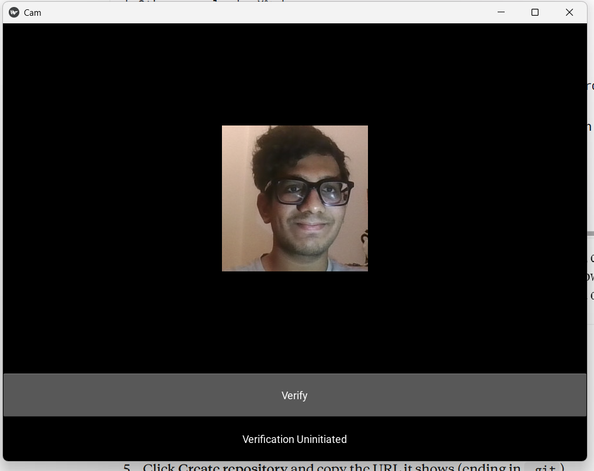

# Real-Time Face Verification with a Siamese Network

A desktop app that verifies a person's identity from a webcam image, built with
TensorFlow/Keras, OpenCV and Kivy.

## How it works
- A Siamese network compares two face images using a shared CNN embedding and an L1 distance layer.
- Trained with binary cross-entropy on matching (anchor–positive) and non-matching (anchor–negative) pairs.
- At verification time, the webcam image is compared against a set of reference images;
  two thresholds decide whether the person is verified.

## My improvements over the original tutorial
- **Webcam-captured negatives** – stopped the model from accepting photos of other people.
- **Face detection cropping** – verification no longer depends on position and background.
- **Data augmentation** – robust to changes in lighting and colour.
- **Fixed train/test leakage** – honest evaluation metrics.
- **Batched verification** – all comparisons in one prediction call, much faster.
- **Updated for Keras 3, NumPy 2 and OpenCV 4** – fixed several compatibility errors.

| Person | Average match rate | Result |
|---|---|---|
| Owner | ~55% | Verified |
| Other people | 0% | Unverified |

## How to run
1. `pip install -r requirements.txt` (Python 3.x)
2. Collect images with `main.py` (collect mode), then run `recrop.py`
3. Train with `main.py` (train mode)
4. Copy the model and verification images into `app/`, then run `python faceid.py` from the `app` folder

## Credits
Based on Nicholas Renotte's face recognition tutorial:
https://github.com/nicknochnack/FaceRecognition
